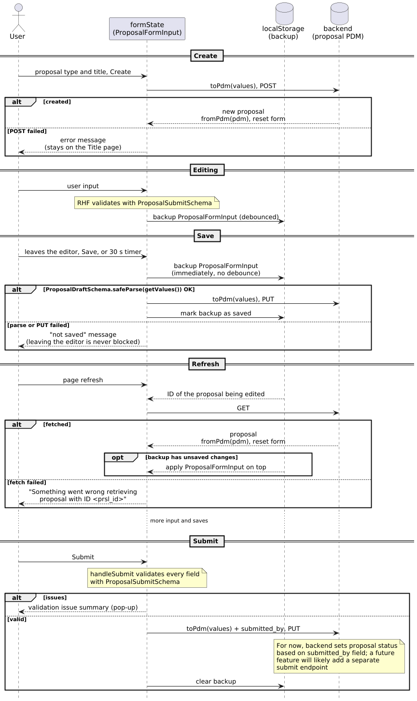
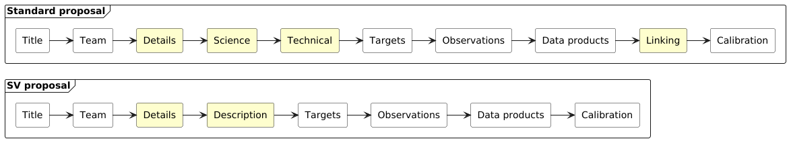

Proposal Editor Architecture
~~~~~~~~~~~~~~~~~~~~~~~~~~~~

.. note::

   The migration to this architecture is still in progress. Parts of the app still use the
   legacy proposal store and mappers. This note is removed when the migration is complete.

The proposal editor keeps all editable proposal data in one proposal-wide form, built with
`React Hook Form <https://react-hook-form.com/>`_ (RHF). Every page reads and writes its fields
in that form, so moving between pages does not lose or reload anything.

`Zod <https://zod.dev/>`_ schemas define what the form data may look like. RHF runs them
through ``@hookform/resolvers`` to show field errors, and the editor runs them before saving
and submitting.

Mappers convert between the form data and the PDM, the proposal type that the backend
accepts. The Project Data Model (PDM) types are generated from the ska-oso-services
OpenAPI spec (``make models``) and are used only at this boundary, never inside the form.

Data flow
=========

   How proposal data moves from the user to the backend.

The form state is the only place where the user edits the proposal. It is converted to the PDM
only when it is sent to the backend, and rebuilt from PDM only when a proposal is created or
loaded. A copy of the form state is kept in local storage: after a page refresh, the proposal
is fetched from the backend and any unsaved changes from that copy are applied on top.

Version conflicts are not handled yet. If the proposal were to change on the server during creation
or editing, the unsaved changes in the form state would overwrite those on the server.

.. admonition:: Status handling
   :class: warning

   The proposal editor does not set or read the proposal status. The backend determines the
   status on every PUT:

   - **Save** sends the mapped proposal and the backend stores it by default as ``draft``.
   - **Submit** sends the mapped proposal plus ``submitted_by`` (the current user). The
     backend sets ``submitted_on`` and stores it as ``submitted``.

   New proposals start in ``draft`` status. The landing page shows the status that the backend
   returns.

   This is how status handling works for now. It will be reworked in both the backend and the
   frontend as part of a future feature.

Schemas
=======

The form state has the type ``ProposalFormInput``. Two Zod schemas validate it. The draft
schema (``ProposalDraftSchema``) checks only the shape of the data and converts it so an
incomplete proposal can still be saved. The submit schema (``ProposalSubmitSchema``) is the
draft schema plus the rules a finished proposal must meet: required fields, formats, minimum
counts and rules that span several pages. The draft schema runs before every save, and the
submit schema runs while the user types (to show field errors) and again when they submit.

Both schemas produce the same output, ``ProposalDraftValues``, so one mapper, ``toPdm``,
turns it into the backend PDM type for both saving and submitting. ``fromPdm`` goes the other
way when a proposal is created or loaded.

The schemas and mappers are built from one module per subgroup of the form, roughly one per
page. The Details subgroup is a good example:

.. code-block:: typescript

   // details.ts
   export function getDetailsSchema() {
     return z.object({
       abstract: z.string(), // shape only: '' and too many words are allowed in a draft
       scienceCategory: z.string().nullable(), // standard proposals only, null until chosen
     });
   }

   export type DetailsValues = z.infer<ReturnType<typeof getDetailsSchema>>;

   // Both fields are optional in the PDM, so fromPdm gives them form defaults
   export const detailsFromPdm = (info: ProposalInfo): DetailsValues => ({
     abstract: info.abstract ?? '',
     scienceCategory: info.science_category ?? null,
   });

   export const detailsToPdm = (
     details: DetailsValues,
   ): Pick<ProposalInfo, 'abstract' | 'science_category'> => ({
     abstract: details.abstract,
     science_category: details.scienceCategory,
   });

Each module is then registered in the proposal schemas and mappers. Rules that only a
finished proposal must meet, or that span subgroups, go in the submit schema:

.. code-block:: typescript

   const ProposalDraftSchema = z.object({
     details: getDetailsSchema(),
     observations: z.array(getObservationSchema()),
     // ...other subgroups and root fields
   });

   const ProposalSubmitSchema = ProposalDraftSchema.superRefine((values, ctx) => {
     const require = (value: unknown, path: (string | number)[]) =>
       value || ctx.addIssue({ code: 'custom', path, message: REQUIRED_MESSAGE });

     require(values.details.abstract, ['details', 'abstract']); // plus the word limit

     // An SV proposal has no science category. Its Details page shows the observing mode
     // instead, which belongs to the observations subgroup.
     if (values.proposalType === PROPOSAL_TYPE.SCIENCE_VERIFICATION) {
       require(values.observations[0]?.type, ['observations', 0, 'type']);
     } else {
       require(values.details.scienceCategory, ['details', 'scienceCategory']);
     }
   });

   function fromPdm(pdm: ProposalPdm): ProposalFormInput {
     return { details: detailsFromPdm(pdm.proposal_info) /* , ...other subgroups */ };
   }

   function toPdm(values: ProposalDraftValues): ProposalPdm {
     return { proposal_info: { ...detailsToPdm(values.details) /* , ...other subgroups */ } };
   }

Validation messages come from the PHT translations.

Science Verification and standard proposals
===========================================

   The pages of a standard and an SV proposal. Highlighted pages differ between the two.

Science Verification (SV) and standard proposals share one form and one set of schemas. The
root field ``proposalType`` decides which pages are shown and which submit rules apply. As
the figure shows, an SV proposal differs from a standard one in three places:

- The Science and Technical pages are combined into one Description page.
- The Details page asks for the observing mode instead of the science category. SV proposals
  have no science category.
- There is no Linking page. An SV proposal has exactly one target, one observation and the
  default data products, and they are linked automatically in the background.
