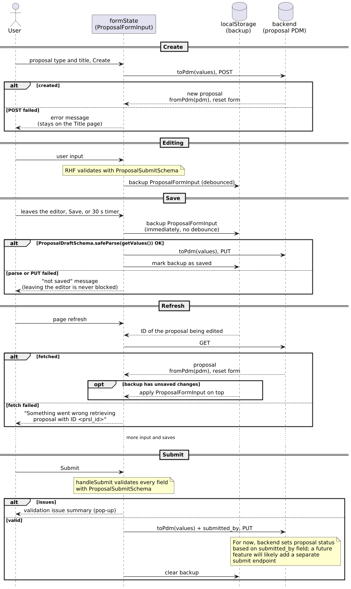

Proposal Editor Architecture
~~~~~~~~~~~~~~~~~~~~~~~~~~~~

.. note::

   The migration to this architecture is still in progress. Parts of the app still use the
   legacy proposal store and mappers. This note is removed when the migration is complete.

   .. TODO: Two or three sentences on the bridge, without naming migrated pages: migrated
      subgroups live in the form and unmigrated ones in the legacy store; on save, the form's
      subgroups are laid over the PDM built by the legacy mappers.

.. TODO: One-paragraph summary: one proposal-wide React Hook Form (RHF) instance, Zod schemas
   composed from one module per subgroup, generated PDM types used only at the API boundary, and
   a local backup of the form state.

Overview
========

.. TODO: Brief list of the libraries and what each is used for:
   - React Hook Form: one proposal-wide form holding all editable proposal data.
   - Zod (with @hookform/resolvers): schemas for validation and conversion.
   - Generated PDM types (OpenAPI Generator, from the ska-oso-services OpenAPI spec, see
     ``make models``): the API contract.
   - @ska-telescope/ska-gui-components controlled fields: bind SKA components to the form.
   - Browser local storage: backup of the form state.

Data flow
=========

   How proposal data moves from the user to the backend.

The form state is the only place where the user edits the proposal. It is converted to PDM
only when it is sent to the backend, and rebuilt from PDM only when a proposal is created or
loaded. A copy of the form state is kept in local storage: after a page refresh, the proposal
is fetched from the backend and any unsaved changes from that copy are applied on top.

Version conflicts are not handled yet. If the proposal changed on the server in the meantime,
the unsaved changes still overwrite it.

.. admonition:: Status handling
   :class: warning

   The proposal editor does not set or read the proposal status. The backend works out the
   status on every PUT:

   - **Save** sends the mapped proposal and the backend stores it by default as ``draft``.
   - **Submit** sends the mapped proposal plus ``submitted_by`` (the current user). The
     backend sets ``submitted_on`` and stores it as ``submitted``.

   New proposals start as ``draft``. The landing page shows the status that the backend
   returns.

   This is how status handling works for now. It will be reworked in both the backend and the
   frontend as part of a future feature.

Schemas
=======

Subgroups
---------

``ProposalFormInput`` is a representation of the form data divided into subgroups roughly
based on the page the form fields are presented in. These route level groups are Details,
Team, Documents, Targets, Observations, Data products, Links (see `Target-observation links`_)
and Calibration. Additionally at the root level includes the proposal type, title, ID and cycle ID.

Every subgroup follows the same pattern. ``title.ts`` is the smallest example: a schema,
the type of its values, and the mappers.

.. code-block:: typescript

   // title.ts
   export function getTitleSchema() {
     return z.string().trim(); // shape and conversion only: '' is allowed in a draft
   }

   export type TitleValues = z.infer<ReturnType<typeof getTitleSchema>>;

   export const titleFromPdm = (info: Pick<ProposalInfo, 'title'>): TitleValues => info.title;

   export const titleToPdm = (title: TitleValues): Pick<ProposalInfo, 'title'> => ({ title });

The subgroup is then registered in the proposal schemas and in the mappers:

.. code-block:: typescript

   const ProposalDraftSchema = z.object({
     title: getTitleSchema(),
     // ...other subgroups and root fields
   });

   const ProposalSubmitSchema = ProposalDraftSchema.superRefine((values, ctx) => {
     // the title is required, has a format and a word limit: these rules go here,
     // not in the draft, so that a draft with an empty title can still be saved
   });

   function fromPdm(pdm: ProposalPdm): ProposalFormInput {
     return { title: titleFromPdm(pdm.proposal_info) /* , ...other subgroups */ };
   }

   function toPdm(values: ProposalDraftValues): ProposalPdm {
     return { proposal_info: { ...titleToPdm(values.title) /* , ...other subgroups */ } };
   }

Validation messages come from the PHT translations. A subgroup schema can also be used on its
own, outside the proposal form.

Draft and submit schemas
------------------------

The proposal has two schemas, both built from the same subgroup schemas. The draft schema
checks only the shape of the data and converts it, so an incomplete proposal can still be
saved. The submit schema is the draft schema plus the rules a finished proposal must meet:
required fields, formats, minimum counts and rules that span several pages. As the data flow
diagram shows, the draft schema runs before every save, and the submit schema runs while the
user types (to show field errors) and again when they submit.

Both schemas take the same input, ``ProposalFormInput`` (the raw form state), and produce the
same output, ``ProposalDraftValues``. So one pair of mappers serves both saving and
submitting.

Schema rules
------------

.. TODO: Conversions turn bad input into null; generated PDM sets the floor; array entries
   are committed whole; page status from submit issues; submit rules match legacy validation;
   controlled fields use null (not undefined) for "no value" so reset clears them.
   What is and isn't form data: sensitivity results are form data (saved, validated, written
   only by the sensitivity operations); dialogs, timers, request IDs and file payloads are not.

Mappers
-------

.. TODO: fromPdm / toPdm composed from subgroup mappers; single mapper for draft
   and submit; round-trip tests.

Target-observation links
========================

.. TODO diagram: entity-relationship diagram of targets, observations and data products, the
   link entries joining them (target ID, observation ID, data product ID, sensitivity
   results), and how each link maps to a PDM result_details entry (target_ref,
   observation_set_ref, data_product_ref). Optionally a second panel for SV: one observation,
   one data product, every target linked automatically.
   .. figure:: ../images/developer/proposalEditorLinks.png

.. TODO: Record the chosen representation (current shape: one entry per target + observation +
   data product with results on the entry, vs separate links and results) and why.

Science Verification and standard proposals
===========================================

.. TODO: Short intro: the proposal type (form field proposalType) decides which pages and
   rules apply.

.. TODO diagram: side-by-side page sets / flows for SV and non-SV.
   .. figure:: ../images/developer/proposalEditorSvVsStandard.png

Page sets
---------

.. TODO: Which pages each proposal type has.

Details and documents
---------------------

.. TODO: SV observing mode (observations[0].type) vs science category; SV Description page vs
   Science and Technical pages.

Observations and data products
------------------------------

.. TODO: SV has exactly one observation and data product created with the proposal, edit only.
   Non-SV can add and delete.

Linking
-------

.. TODO: SV autolinking (adding a target links it; changing observing mode regenerates) vs
   the non-SV Linking page.
